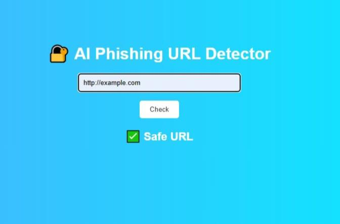
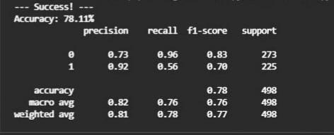

# AI-Based Phishing URL Detection

A machine-learning system that classifies a URL as **Safe** or **Phishing**, with a Flask web dashboard where users can paste a URL and get a prediction in real time.

> Built as the project component of my cybersecurity internship at the Government Tool Room and Training Centre (GTTC), Hubli (2025-2026).
> **My contribution:** [write 1-2 lines, e.g. built the full pipeline: data preparation, TF-IDF features, Random Forest training/evaluation and the Flask dashboard]

## Problem
Phishing links trick people into giving away passwords and banking details. This project trains a model on the text of a URL itself to flag likely phishing links automatically.

## How it works
1. Load a labelled dataset of phishing and safe URLs (`urls.csv`).
2. Clean the data and convert URLs to strings.
3. Convert each URL to numbers with **TF-IDF** vectorization.
4. Split into training and test sets and train a **Random Forest** classifier.
5. Evaluate with accuracy, precision, recall and F1-score.
6. Save the trained model and vectorizer with pickle (`model.pkl`).
7. The Flask app loads the model, takes a URL from the user and shows **Safe URL** or **Phishing URL**.

## Tech stack
Python, Scikit-learn, Pandas, NumPy, Flask, TF-IDF, Pickle, VS Code

## Project structure
- `train.py` – trains and evaluates the model
- `predict.py` – predicts whether a URL is safe or phishing
- `app.py` – Flask dashboard
- `urls.csv` – dataset of phishing and safe URLs
- `model.pkl` – saved model and vectorizer

## Results
Evaluated on a held-out test set of 498 URLs.

| Metric | Value |
|---|---|
| Accuracy | **78.11%** |

| Class | Precision | Recall | F1-score | Support |
|---|---|---|---|---|
| Safe (0) | 0.73 | 0.96 | 0.83 | 273 |
| Phishing (1) | 0.92 | 0.56 | 0.70 | 225 |

**What the numbers mean:** when the model flags a URL as phishing it is usually right (precision 0.92), but it currently misses about 44% of phishing URLs (recall 0.56). For a security tool, missing phishing links is the bigger risk, so improving phishing recall is the main next step.

## Dataset
[Dataset name and link]

## How to run
1. Install the requirements: pip install flask scikit-learn pandas numpy
2. Train the model: python train.py
3. Start the dashboard: python app.py
4. Open the local address shown in the terminal (usually http://127.0.0.1:5000) and enter a URL.

To test from the command line, run python predict.py.

## Limitations and future improvements
- Add hand-crafted URL features such as length, number of dots and digits, use of "@" or IP addresses, HTTPS, and special characters, alongside TF-IDF
- Improve phishing recall by balancing classes, tuning the decision threshold and trying models such as XGBoost or logistic regression
- Train on a larger and more recent dataset and test on unseen domains
- Add domain-age and WHOIS lookups, or check against known blocklists
- Deploy online and add a browser extension

## Author
Bibi Zainab – [LinkedIn](https://www.linkedin.com/in/bibi-zainab-dhalayat-929b2b41a) | [GitHub](https://github.com/zk946190-ui)
